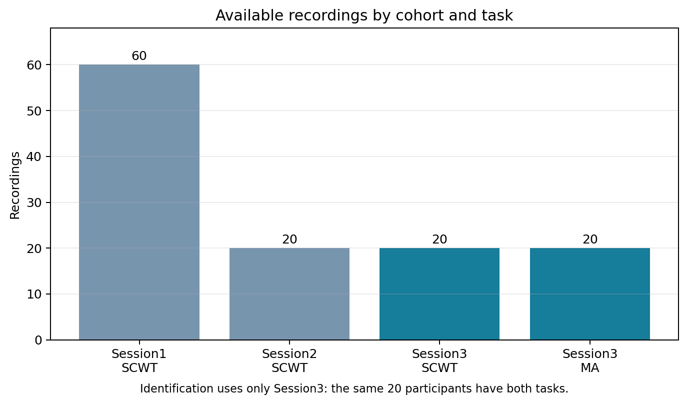
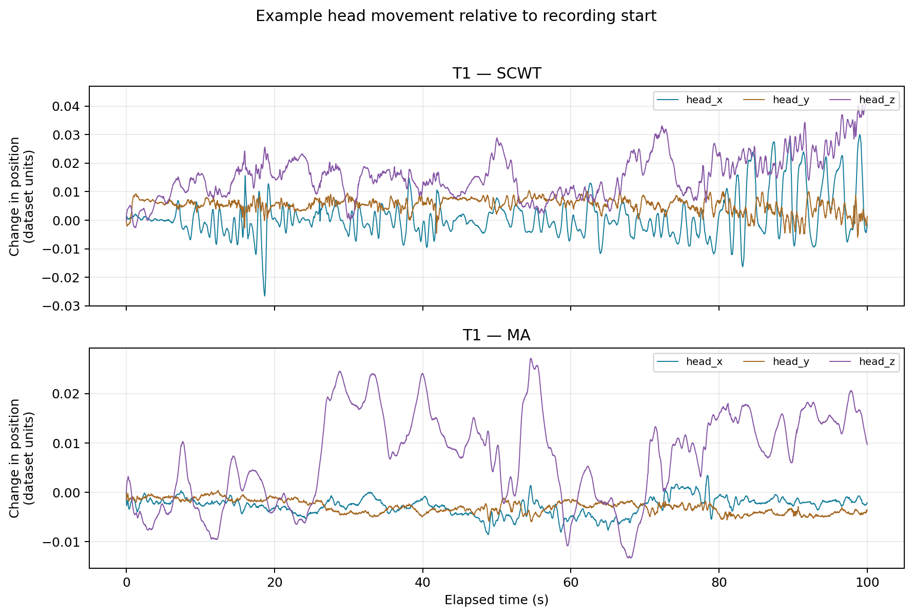
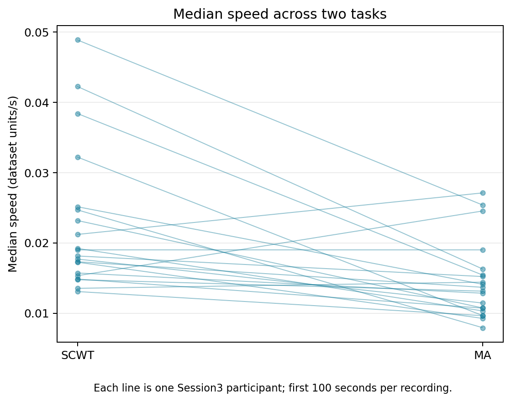
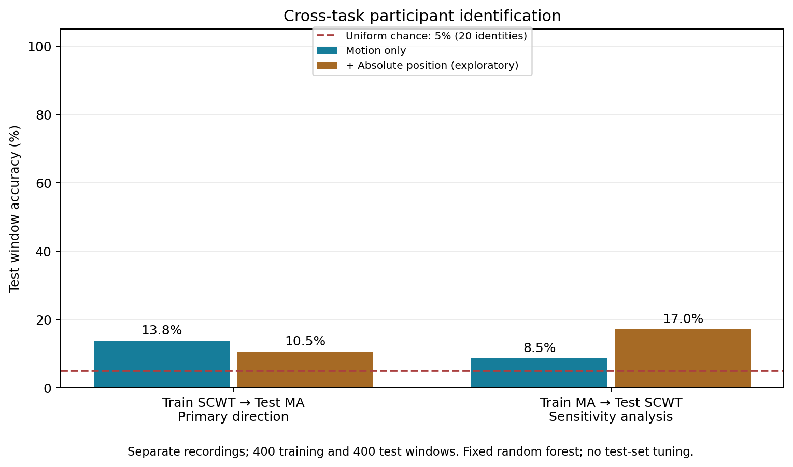
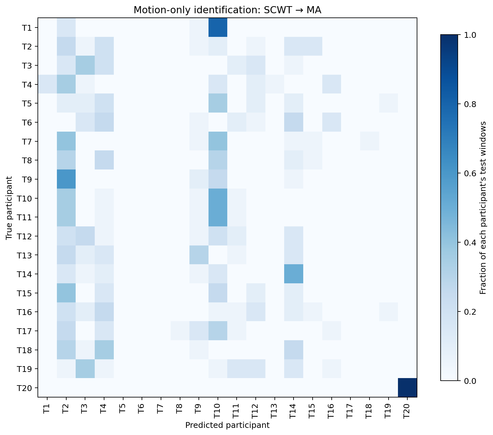
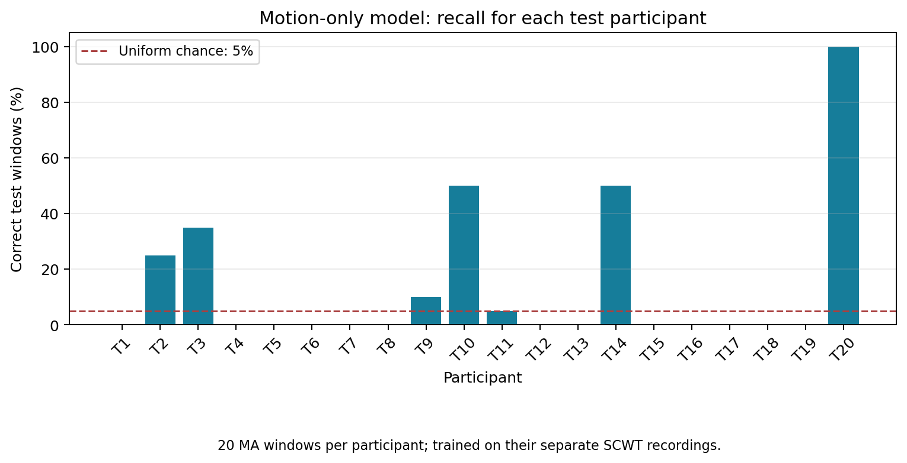
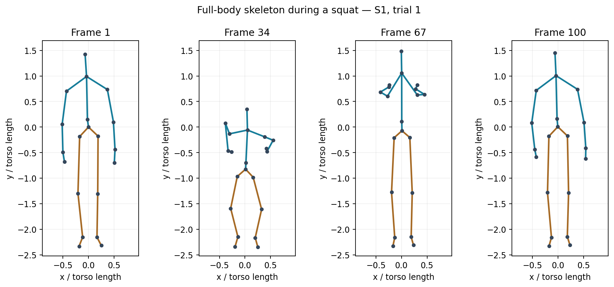
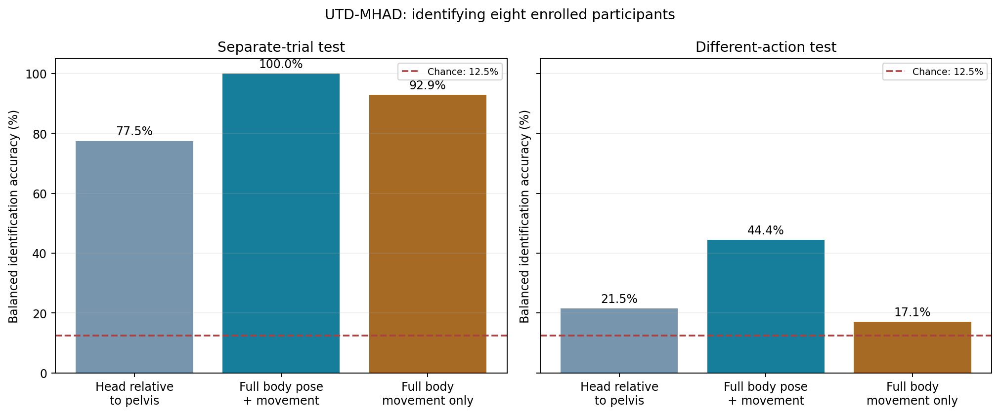
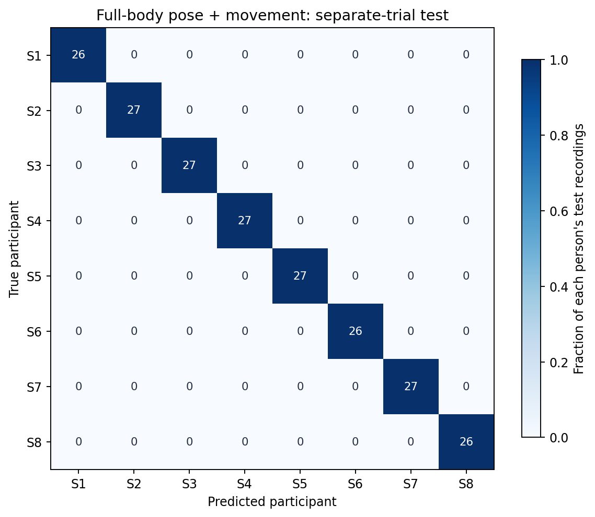

# Liz's head and body movement contribution

ECE 535 mixed reality privacy project. Prepared for Shashwat and the team on November 25, 2026.

This folder contains Liz's saved head-movement and full-body participant-identification studies, their metrics, figures, code, dataset information, and limitations. **The existing runs are preliminary**: the head study was run November 17 and the body study November 18, 2026. Uploading these files does not establish final team approval or a new experiment run.

The head study obtained 13.75% window accuracy among 20 enrolled people (5% uniform chance). The body study obtained 100% recording accuracy for pose plus movement among eight enrolled people, with substantial evidence that body proportions contribute. These percentages come from different datasets and evaluation units and cannot establish a head-versus-body sensing effect.

## Files to start with

| Need | File |
|---|---|
| Analysis code and saved outputs for both studies | [Complete notebook](ECE535_Head_Movement_Analysis.ipynb) |
| Head metrics | [Head results CSV](head_identification_metrics.csv) |
| Body metrics | [Body results CSV](body_identification_metrics.csv) |
| Head results, predictions, features, manifests and figures | [Original head results package](ECE535_Preliminary_Results.zip) |
| Body results, predictions, features, split manifest, figures and animation | [Original body results package](ECE535_Full_Body_Results.zip) |
| Head preprocessing and sensor columns | [Preprocessing notes](head_preprocessing_notes.md) and [script](preprocess_head_movements.py) |
| Body dataset, citation and access details | [Dataset guide](body_DATASET_GUIDE.txt) |
| Plain-language findings and limitations | [Head explanation](head_results_explained.txt) and [body explanation](body_results_explained.txt) |
| Recorded run configurations | [Head manifest](head_run_manifest.json) and [body manifest](body_run_manifest.json) |

## Head movement study

### Dataset and citation

Roma Tre Head Movement Dataset: [dataset landing page](https://muse.uniroma3.it/headdataset/) and [authors' dataset README](https://github.com/MUSEResearchGroup/stress-assessment-head-movement#dataset).

Citation recorded in the notebook: Ferrarotti, Baldoni, Carli and Battisti (2024), *Stress Assessment for Augmented Reality Applications Based on Head Movement Features*. DOI: [10.1109/TVCG.2024.3385637](https://doi.org/10.1109/TVCG.2024.3385637).

The identification cohort is **20 participants, T1–T20, from Session3**, each with one Stroop color-word task (SCWT) and one mental arithmetic (MA) recording. Other dataset cohorts have only one recording per identity and are excluded from this separate-recording experiment. The original source study concerns stress assessment; this project repurposes its movement data for an identification baseline.

Sensor inputs are head position `head_x`, `head_y`, `head_z` and recorded timestamps. Preprocessing adds elapsed time, finite-difference velocity, speed, acceleration and quality flags. Position units remain the dataset's original units. No eye, hand or body tracking enters this experiment.

### Preprocessing, model and evaluation

The preprocessing script parses timestamps, retains original samples, and derives motion using actual time intervals. It does not smooth, interpolate or discard the original rows. It flags duplicate timestamps; undefined derivatives remain missing. The preprocessing notes record 255 duplicate-timestamp samples in the complete processed dataset. Questionnaire tables are not merged into the sample data. Timing-based task-phase labels are metadata and are not identification predictors.

The model uses the **first 100 seconds** of each recording, divided into **twenty non-overlapping five-second windows**. A usable window must have at least 200 usable samples and 4.8 seconds of observed span. The primary split trains on **20 SCWT recordings / 400 windows** and tests on **20 separate MA recordings / 400 windows**, retaining the same 20 enrolled identities. Each five-second window receives one prediction. No recording is split across training and test.

The primary model is a fixed random forest with 300 trees, minimum leaf size 2, square-root feature selection, balanced subsampling and seed 535. Its 18 motion predictors summarize per-axis standard deviation, interquartile range, range and endpoint displacement, plus median, 90th percentile and interquartile range of speed and acceleration magnitude. These features remove fixed position offsets. An exploratory condition adds mean absolute x/y/z position. IDs, file paths, tasks, timestamps, window index and phase labels are excluded from predictors. There was no test-set hyperparameter search.

### Saved results

| Direction | Features | Accuracy | Balanced accuracy | Macro F1 |
|---|---|---:|---:|---:|
| SCWT → MA | Motion only (primary) | 13.75% | 13.75% | 0.1009 |
| SCWT → MA | Motion + absolute position (exploratory) | 10.50% | 10.50% | 0.0954 |
| MA → SCWT | Motion only (primary) | 8.50% | 8.50% | 0.0499 |
| MA → SCWT | Motion + absolute position (exploratory) | 17.00% | 17.00% | 0.1317 |

Every row uses 20 training and 20 test recordings, 400 training and 400 test windows, and 20 participants. Uniform chance is 5%. The primary result is motion-only SCWT to MA: **55 of 400 test windows correct**, with at least one correct window for 7 of 20 participants. The reverse direction is a sensitivity analysis on the same cohort.

### Limitations

This is small-cohort, closed-set, cross-task identification. It does not establish different-day, different-device or unenrolled-person recognition. Windows within each recording are correlated; 400 test windows are not 400 independent people. No window-level confidence interval or significance claim is made. Finite-difference derivatives can be noisy; units and capture context limit interpretation. Position-offset invariance does not remove all body size, orientation or environmental information. Absolute-position conditions may capture placement or context.

## Full body skeleton study

### Dataset and citation

UTD Multimodal Human Action Dataset (UTD-MHAD): [official dataset page](https://personal.utdallas.edu/~kehtar/UTD-MHAD.html), [skeleton-only archive](https://personal.utdallas.edu/~kehtar/UTD-MAD/Skeleton.zip), and [original paper](https://jafari.tamu.edu/wp-content/uploads/2019/06/ICIP2015-Chen-Final.pdf).

Citation: C. Chen, R. Jafari and N. Kehtarnavaz, *UTD-MHAD: A Multimodal Dataset for Human Action Recognition Utilizing a Depth Camera and a Wearable Inertial Sensor*, IEEE International Conference on Image Processing (ICIP), 2015.

The saved analysis contains **861 recordings, eight participants, 27 actions and 20 tracked joints**, after three absent trial-4 recordings in the release. Inputs are 3D joint-coordinate sequences, MATLAB variable `d_skel`, shaped 20 joints by 3 coordinates by frames. Joints cover the head, spine, pelvis, arms, hands, legs and feet. Official joint order has head first and pelvis fourth. RGB, depth and IMU modalities are not used.

The saved archive audit records **58,299 frames**, with **41–125 frames per recording**. Nominal capture is approximately 30 fps, corresponding roughly to 1.4–4.2 seconds per complete sequence; these are approximate durations, not measurements from exact timestamps. The model evaluates each complete recording. Raw coordinate units are not asserted.

### Preprocessing, model and evaluation

The loader checks the archive hash, array shape, finite coordinates, zero-joint frames and nonzero torso scale. Each frame is centered on the pelvis; coordinates are divided by the recording's median shoulder-center-to-pelvis length. This removes absolute camera translation and overall torso scale, while retaining orientation and relative proportions.

Three fixed feature sets use identical examples and splits:

- **Head relative to pelvis:** 17 head position and frame-change summaries.
- **Full body pose plus movement:** 323 predictors, comprising 17 summaries for each of 19 non-pelvis joints.
- **Full body movement only:** 95 frame-change summaries, excluding static position means and position variability summaries.

Position summaries are coordinate means, standard deviations, interquartile ranges and ranges. Dynamic summaries are median and 90th-percentile step lengths and coordinate-wise step standard deviations. Changes are measured per frame. Participant IDs, action labels, trials, filenames and recording lengths are not predictors.

The fixed random forest uses 300 trees, minimum leaf size 2, square-root feature selection, balanced subsampling and seed 535, without test-set tuning. **Primary split:** trials 1–3 train, trial 4 test, giving **648 training and 213 test recordings**. **Exploratory split:** actions 1–21 train, actions 22–27 test, giving **671 training and 190 test recordings**. Both retain the same eight enrolled identities. Each complete recording receives one prediction; uniform chance is 12.5%. See the [split manifest](body_split_manifest.csv) and [recording manifest](body_recording_manifest.csv).

### Saved results

| Protocol | Features | Train / test recordings | Accuracy | Balanced accuracy | Macro F1 |
|---|---|---:|---:|---:|---:|
| Held-out trial 4 (primary) | Head relative to pelvis | 648 / 213 | 77.46% | 77.49% | 0.7771 |
| Held-out trial 4 (primary) | Full body pose + movement | 648 / 213 | 100.00% | 100.00% | 1.0000 |
| Held-out trial 4 (primary) | Full body movement only | 648 / 213 | 92.96% | 92.91% | 0.9302 |
| Held-out actions 22–27 (exploratory) | Head relative to pelvis | 671 / 190 | 21.58% | 21.49% | 0.1808 |
| Held-out actions 22–27 (exploratory) | Full body pose + movement | 671 / 190 | 44.21% | 44.38% | 0.4388 |
| Held-out actions 22–27 (exploratory) | Full body movement only | 671 / 190 | 16.84% | 17.14% | 0.1158 |

A post-hoc relative-bone-length-only diagnostic achieved **93.02% balanced accuracy** on the primary split. All 861 numerical sequences were distinct, with no exact recording duplicates found. The diagnostic did not alter or tune the primary model.

### Limitations

High separate-trial accuracy is not evidence of purely behavioral identification: static proportions, pose, orientation, tasks and tracking context can contribute. Movement-only features reduce static descriptors without removing every shape or context effect. Feature sets differ in information and dimension; this is not a capacity-matched sensor comparison. Trial separation does not establish different-day, different-camera or unenrolled-person recognition. The cross-action experiment reuses the cohort and is exploratory. The source is laboratory Kinect skeleton capture designed for action recognition, with limited direct correspondence to deployed headset tracking.

## Figures and report captions

Figure numbering below is local to this contribution and can be adjusted in the combined report. PNG and matching PDF versions are included for all nine figures.

### Figure H1 Dataset coverage

**Caption:** Available head-movement recordings by cohort and task. Participant identification uses Session3 only, where the same 20 participants each have an SCWT and an MA recording.

### Figure H2 Example head movement

**Caption:** Head x/y/z position change relative to the recording start for participant T1 during SCWT and MA, restricted to the first 100 seconds. Axes retain dataset coordinate units.

### Figure H3 Paired task speed

**Caption:** Median head speed in the first 100 seconds of each task, paired within each Session3 participant. Lines connect the two task summaries for one person. This is descriptive, without a significance or causal claim.

### Figure H4 Head identification accuracy

**Caption:** Window-level identification accuracy for 20 enrolled participants across separate task recordings. The primary motion-only SCWT-to-MA score is 13.75% against 5% uniform chance; reverse-direction and added absolute-position conditions are sensitivity analyses. Each direction uses 400 training and 400 test five-second windows.

### Figure H5 Head confusion matrix

**Caption:** True-row-normalized confusion matrix for the primary motion-only SCWT-to-MA classifier. Each row represents one person's 20 MA test windows; columns show predicted identity. The primary classifier correctly labels 55 of 400 test windows.

### Figure H6 Recall by participant

**Caption:** Recall for each participant in the primary head experiment, measured across 20 MA windows per person after training on separate SCWT recordings. Performance varies substantially; seven participants have at least one correctly identified window.

### Figure B1 Full body pose sequence

**Caption:** Reconstructed 20-joint squat sequence for UTD-MHAD participant S1, trial 1. Display coordinates are relative to the first-frame pelvis and scaled by median torso length, preserving visible vertical movement. This visualization uses joint coordinates rather than photographs.

### Figure B2 Full body identification accuracy

**Caption:** Recording-level balanced identification accuracy for eight enrolled UTD-MHAD participants, comparing head-relative, full-body pose/movement and movement-only features on identical splits. The primary separate-trial test uses 648 training and 213 test recordings; the exploratory different-action test uses 671 and 190. Uniform chance is 12.5%. Feature dimensions differ between conditions.

### Figure B3 Full body confusion matrix

**Caption:** Primary full-body pose/movement confusion matrix for held-out trial 4. Color shows each true participant's fraction of test recordings, and cell labels show recording counts. All 213 test recordings are correctly classified in this small-cohort evaluation; this does not establish robustness to a new day, camera or person.

[View the skeleton animation](body_full_body_squat.gif).

## Reproducing and integrating the analysis

Open the notebook in Jupyter or Google Colab. Dependencies used by the code include NumPy, pandas, Matplotlib, SciPy, scikit-learn and IPython; the existing run manifests record versions for the saved runs.

For the head study, provide `head_movement_cleaned.csv` and set `DATA_PATH` or use the notebook's file picker, then run sections 1–10 in order. The approximately 207 MB cleaned head CSV is not included in this repository upload. The preprocessing script and notes describe how it was produced from the original dataset. Local filesystem paths are not usable inside Colab; choose or mount the data there.

The full-body study runs independently in sections 11–16 and downloads the official skeleton-only archive, then verifies its SHA-256 hash. The raw skeleton archive is not included here. The original ZIP packages preserve their existing folder structures, while files displayed directly in this folder have head/body filename prefixes for clarity.

The analysis exports metrics, predictions, feature tables, manifests and figures. A combined team demo command and integration interface are not established by this notebook and need to be agreed with the integration owner.

## Comparison and privacy interpretation

Keep the Roma Tre and UTD-MHAD studies separate in the combined results table: they use different participants, class counts, tasks, sensors, observation durations and scoring units. A direct within-dataset head-relative versus body comparison is available in UTD-MHAD because those conditions use identical recordings and splits. Eye-gaze and hand-gesture results need their own protocol details before a comparison can be interpreted.

Within these enrolled cohorts, movement and skeleton measurements contain information associated with identity. The body-proportion diagnostic shows why a high body score must not be attributed solely to movement style. These findings motivate attention to retained pose/proportion information even after translation and scale normalization, while remaining specific to the tested datasets and conditions.

## Remaining handoff items

- Confirm with the team whether the existing preliminary runs are the results to use for the final report, or whether additional experiments are required.
- Insert the selected figures and the captions above using the combined report's numbering and citation style.
- Agree on comparison metrics, prediction unit and demo integration with the team.
- Cross-day, cross-device and unenrolled-person evaluations are not included in these saved runs.
